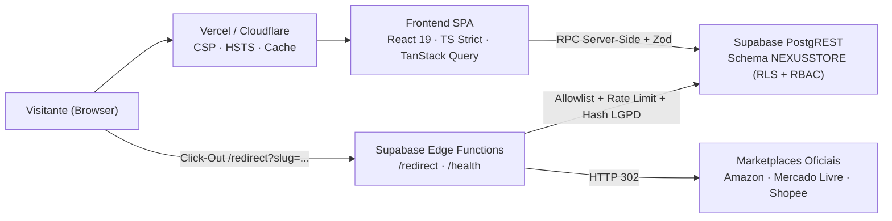

# Nexus Store

[](https://github.com/Christyan95/NexusStore/actions/workflows/ci.yml)


> **Vitrine moderna de curadoria e ofertas de afiliados** (Amazon, Mercado Livre e Shopee) projetada com arquitetura modular em TypeScript estrito, banco PostgreSQL sob governança corporativa (`model_db`), Edge Functions com rastreamento LGPD de cliques e esteira DevSecOps completa.

---

## Visão Geral do Produto

O **Nexus Store** centraliza ofertas selecionadas dos principais marketplaces do Brasil em uma experiência rápida, acessível e juridicamente transparente:

- **Curadoria Transparente (Compliance CDC):** zero descontos fictícios e zero notificações simuladas de compra — descontos só são exibidos quando há preço anterior real auditável (`PROR_PROD >= PRAT_PROD`), com data/hora da última sincronização (`SINC_PROD`).
- **Busca & Filtragem Server-Side:** busca Full-Text Search em Português (`portuguese`) com paginação controlada diretamente no PostgreSQL, filtros por categoria, plataforma e destaque (_Em Alta_) sincronizados com a URL (`?q=&categoria=&plataforma=&destaque=&ordem=&pagina=`).
- **Segurança de Links (Anti-Phishing):** redirecionamento validado em 3 camadas (banco, Edge Function e frontend) restrito a `https://` e domínios oficiais/encurtadores autorizados.
- **Telemetria Real com Privacidade (LGPD):** cliques de saída contabilizados em tabela particionada mensalmente (`"NEXUSSTORE"."CLIC_AFIL"`) com pseudonimização SHA-256 + salt do IP de origem.

---

## Arquitetura



### Camadas e Estrutura de Diretórios

```text
NexusStore/
├── .github/
│   ├── workflows/ci.yml                # Quality Gates: Gitleaks, Prettier, TS, ESLint, Vitest, SCA e SBOM
│   └── dependabot.yml                  # Atualizações semanais de dependências (npm e Actions)
├── db/migrations/                      # Migrations SQL versionadas e idempotentes (padrão model_db)
│   ├── V1.0.0__create_prod_afil.sql    # Schema NEXUSSTORE, WIKI, CATE_PROD, PLAT_AFIL, PROD_AFIL, RLS e Triggers
│   ├── V1.1.0__wiki_prod_afil.sql      # Catálogo ativo WIKI_TABELA / WIKI_COLUNA (UPSERT idempotente)
│   ├── V1.2.0__mock_prod_afil.sql      # Carga inicial idempotente (7 categorias, 3 plataformas, 98 produtos)
│   ├── V1.3.0__rpc_catalogo_e_bridge.sql # RPCs server-side, bridge Supabase e migração Expand-and-Contract
│   └── V1.4.0__create_clic_afil.sql    # Telemetria particionada CLIC_AFIL (12 meses + DEFAULT) + WIKI
├── docs/architecture/                  # ADRs (001–004) e Plano de Migração Strangler Fig
├── supabase/functions/                 # Edge Functions Deno: /health e /redirect
├── src/
│   ├── core/                           # Env Zod (fail-closed), Result/AppError, Allowlist URLs e Logger
│   ├── modules/catalog/
│   │   ├── domain/                     # Entidades, constantes, precificação e filtragem pura (0 deps de framework)
│   │   ├── application/                # Portas (DIP) e ListCatalogUseCase
│   │   ├── infrastructure/             # Contratos Zod, cliente Supabase com timeout e adaptador RPC
│   │   └── presentation/               # Hooks (TanStack Query, URL sync, debounce), componentes a11y e página
│   └── shared/ui/                      # ErrorBoundary e BrandLogo vetorial (< 1 KB)
├── vercel.json                         # Headers HTTP de segurança + rewrites SPA (Vercel)
├── public/_headers                     # Headers HTTP de segurança (Cloudflare Pages / Netlify)
├── SECURITY.md                         # Postura de segurança e política de reporte
└── CHANGELOG.md                        # Histórico de versões
```

### Documentação Arquitetural (ADRs)

- [ADR-001 — Arquitetura Modular Pragmática (Feature-Sliced Clean)](docs/architecture/ADR-001-arquitetura-modular-clean.md)
- [ADR-002 — Modelagem `model_db` e Estratégia Expand-and-Contract](docs/architecture/ADR-002-modelagem-dados-model-db-e-expand-contract.md)
- [ADR-003 — Paginação Server-Side (RPC), Validação Zod e Estado](docs/architecture/ADR-003-paginacao-server-side-e-contratos-zod.md)
- [ADR-004 — Segurança de Redirecionamento, Headers HTTP e Compliance CDC](docs/architecture/ADR-004-seguranca-urls-compliance-cdc.md)
- [Plano de Migração Incremental & Rollback](docs/architecture/MIGRATION_PLAN.md)

---

## Stack Tecnológica

| Camada                 | Tecnologia                                                  | Propósito                                                                 |
| ---------------------- | ----------------------------------------------------------- | ------------------------------------------------------------------------- |
| **Frontend**           | React 19, TypeScript 5.8 (Strict), Vite 7                   | UI modular, tipagem estrita e _code splitting_ (`manualChunks`)           |
| **Estilização**        | Tailwind CSS v4 (`@tailwindcss/postcss`)                    | Tokens `@theme`, responsividade e CSS mínimo                              |
| **Estado & Contratos** | TanStack Query v5, Zod                                      | Cache de servidor, cancelamento `AbortSignal` e validação na borda        |
| **Banco de Dados**     | PostgreSQL / Supabase (`NEXUSSTORE`)                        | Normalização, RLS, RBAC, FTS Português, particionamento e WIKI            |
| **Backend Edge**       | Supabase Edge Functions (Deno)                              | `/health` (probe de latência) e `/redirect` (allowlist, rate limit, LGPD) |
| **Qualidade & CI/CD**  | Vitest, Testing Library, ESLint 9, Prettier, GitHub Actions | Cobertura > 80%, Gitleaks, `npm audit` e SBOM CycloneDX                   |

---

## Setup Local

### Pré-requisitos

- **Node.js `>= 22`** e **npm `>= 10`**
- Projeto ativo no **Supabase** com as migrations aplicadas

### 1. Instalar dependências e configurar ambiente

```bash
npm ci
cp .env.example .env.local
```

Preencha `.env.local`:

```env
VITE_SUPABASE_URL=https://<seu-project-ref>.supabase.co
VITE_SUPABASE_ANON_KEY=<sua-anon-key>
VITE_REDIRECT_BASE_URL=https://<seu-project-ref>.supabase.co/functions/v1/redirect
VITE_USE_DEV_FIXTURE=false
```

> **Modo offline (somente desenvolvimento):** defina `VITE_USE_DEV_FIXTURE=true` para carregar a fixture local sem Supabase. Em builds de produção (`vite build`), essa flag é ignorada automaticamente (_fail-closed_).

### 2. Iniciar em desenvolvimento

```bash
npm run dev
```

---

## Provisionamento de Banco & Edge Functions (Supabase)

### Migrations SQL (`db/migrations/`)

Execute em ordem transacional no Supabase SQL Editor (ou via Flyway / `psql`):

1. `V1.0.0__create_prod_afil.sql`
2. `V1.1.0__wiki_prod_afil.sql`
3. `V1.2.0__mock_prod_afil.sql` _(carga inicial — 98 produtos)_
4. `V1.3.0__rpc_catalogo_e_bridge.sql`
5. `V1.4.0__create_clic_afil.sql`

Em seguida, no Supabase Dashboard, adicione **`NEXUSSTORE`** em **Project Settings > Data API > Exposed schemas**.

### Edge Functions (`health` e `redirect`)

```bash
npx supabase login
npx supabase link --project-ref <SEU_PROJECT_REF>

npx supabase secrets set \
  CLICK_IP_HASH_SALT="$(node -e "console.log(require('crypto').randomBytes(32).toString('hex'))")" \
  ALLOWED_ORIGINS="https://seu-dominio.com.br,http://localhost:5173"

npx supabase functions deploy health --no-verify-jwt
npx supabase functions deploy redirect --no-verify-jwt
```

---

## Scripts de Qualidade

```bash
npm run verify         # Executa TODOS os quality gates (format:check + typecheck + lint + test + build)
npm run typecheck      # Checagem estrita TypeScript (tsc --noEmit)
npm run lint           # ESLint com typescript-eslint (type-checked)
npm run format         # Formatação automática com Prettier
npm run format:check   # Validação de formatação
npm run test           # Suíte Vitest + Testing Library
npm run test:coverage  # Relatório de cobertura V8
npm run build          # Build de produção com sourcemaps ocultos e code splitting
```

---

## Segurança & Governança

Consulte [SECURITY.md](SECURITY.md) para detalhes sobre controles OWASP Top 10, RLS/RBAC, conformidade LGPD e reporte responsável de vulnerabilidades.
